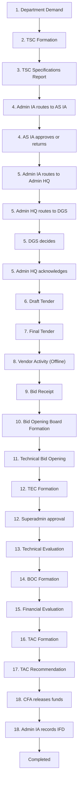
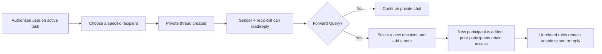
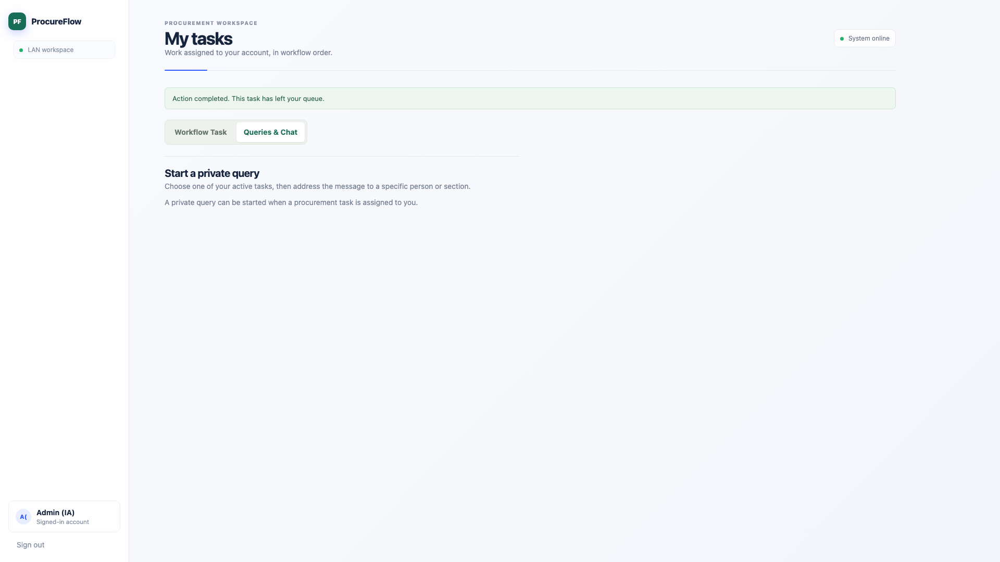

# ProcureFlow

ProcureFlow is a role-restricted procurement workflow application for government and institutional operations. It guides a procurement from department demand through technical scrutiny, tendering, bid evaluation, technical recommendation, CFA funding, and IFD confirmation.

The interface is task-centric: after signing in, a user sees only projects currently assigned to that account, plus private query threads in which the user is an explicitly authorized participant. Workflow roles are enforced by the server, not just hidden in the browser.

## Contents

- [Quick Start](#quick-start)
- [Login and Role Isolation](#login-and-role-isolation)
- [Workspace Layout](#workspace-layout)
- [Lifecycle at a Glance](#lifecycle-at-a-glance)
- [Stage-by-Stage Guide](#stage-by-stage-guide)
- [Committee Rules](#committee-rules)
- [Documents and Deadlines](#documents-and-deadlines)
- [Queries and Chat Privacy](#queries-and-chat-privacy)
- [Audit Trail](#audit-trail)
- [Validation and Troubleshooting](#validation-and-troubleshooting)
- [Development and Testing](#development-and-testing)
- [Project Structure](#project-structure)

## Quick Start

### Requirements

- Node.js 20 or newer
- npm
- A supported operating system with the native build prerequisites for `better-sqlite3`

### Install and run

```bash
npm install
npm run check
npm run build
npm start
```

Open `http://localhost:3000`. To run the development server instead:

```bash
npm run dev
```

Vite serves the browser app at `http://localhost:5173` and proxies API requests to the Express server. The API defaults to port `3000`; set `PORT` if that port is in use. For example:

```bash
PORT=3002 npm run dev
```

The Vite proxy follows `PORT` automatically. `API_PROXY_TARGET` can override the proxy target when the API runs on a different host.

The application creates `procureflow.sqlite` in the current working directory on first run. This file contains projects, workflow state, documents, committee records, messages, and audit events. Back it up with the application stopped. Do not delete it to reset the demo unless you intentionally want to erase all local records.

## Login and Role Isolation

Each demo account has a fixed role. Sign out and sign in with another account to test a different role; there is no in-app role switcher. Demo credentials are for local evaluation only.

| Role | Username | Password | Typical task |
|---|---|---|---|
| Department | `department` | `department123` | Raise a procurement demand |
| Admin (IA) | `adminia` | `adminia123` | Review demands, route files, constitute committees, record bids and IFD |
| Admin (HQ) | `adminhq` | `adminhq123` | Route DGS files and prepare draft tenders |
| TSC / Committee Member | `tsc` | `tsc123` | Submit technical reports, open bids, evaluate and recommend |
| AS (IA) / IA Wing | `ia` | `ia123` | Review and approve/return TSC specifications |
| HQ liaison | `hq` | `hq123` | Compatibility account; current stage assignment is shown to `adminhq` |
| DGS | `dgs` | `dgs123` | Decide the DGS approval handoff |
| Superadmin (SS) | `superadmin` | `admin123` | Approve TEC formation |
| CFA | `cfa` | `cfa123` | Release approved funds through IFD |

After authentication, the server returns only projects whose current stage and handoff phase are assigned to the signed-in role. Completed projects and projects assigned to another role are not displayed in **Workflow Task**. The project action API, project log endpoint, document endpoint, committee endpoint, and query APIs enforce the same role/participant boundaries.

Department can create a demand from the workspace header. Once submitted, the demand leaves the Department queue and appears in Admin (IA)'s task queue. Completing a task removes it from the current user's queue; the next authorized role sees it after signing in. Users can still see a private conversation when explicitly listed as a participant, even if they do not have a workflow task for that project.

### First-load brand splash

The centered PF intro runs once per browser tab session. The app stores `pf_intro_played` in `sessionStorage`; reloads, login/logout, and workspace tab changes keep the logo in its resting position. Opening a fresh tab starts a new intro. Users who prefer reduced motion skip the flight animation.

## Workspace Layout

The workspace has two tabs:

1. **Workflow Task** shows active items assigned to the signed-in account. Open a card to review the current action, complete its form, and inspect task documents, committee membership, and the task audit trail.
2. **Queries & Chat** shows private conversations for which the account is a sender or an explicitly added participant. Its badge counts active threads in that user's inbox. The tab also provides a composer tied to one of the user's currently assigned procurement tasks.

There is no global project browser or workflow directory in the task interface. An empty task queue means there is no current workflow action assigned to the account; a participant may still have private threads in **Queries & Chat**.

## Lifecycle at a Glance

The procurement uses exactly eighteen numbered stages. Stage 4 and stage 5 contain role handoffs without adding extra numbered stages.



The four offline phases are vendor activity, technical bid opening, technical evaluation, and financial evaluation. The application records the responsible committee's workflow action and remarks; the actual off-system procurement activity occurs outside the application.

## Stage-by-Stage Guide

For each step below, the active task appears only for its named action owner. An action requires remarks and is validated by the server. After a successful handoff, the project leaves that user's queue.

| # | Stage and action owner | What to do | Required inputs and resulting handoff |
|---|---|---|---|
| 1 | **Department Demand** — Department initiates; Admin (IA) reviews | Department selects **Raise demand**, enters the requirement, and submits it. Admin (IA) reviews the demand from its task queue. | Title, description, estimated value, demanding department, demand deadline, remarks, and optional requirement PDF. Admin (IA) accepts to open stage 2. |
| 2 | **TSC Formation** — Admin (IA) | Select the TSC members and chairperson, then constitute the committee. | Exactly three unique active people; the chairperson must be one of them. Remarks are required. The task advances directly to stage 3; TSC approval is not a separate numbered stage. |
| 3 | **TSC Specifications Report** — TSC / Committee | Prepare and submit the specifications report for Admin (IA). | At least 20 characters describing technical requirements, criteria, and recommendation; remarks are required. The report goes to stage 4, Admin (IA) routing. |
| 4 | **AS (IA) Review** — Admin (IA), then AS (IA) | Admin (IA) routes the report. AS (IA) reviews and either approves or returns it to TSC. | Routing and decision remarks. Approval moves to stage 5 at Admin (IA); return moves back to stage 3. Clarifications use **Queries & Chat**, not a workflow decision. |
| 5 | **DGS Approval** — Admin (IA) → Admin (HQ) → DGS → Admin (HQ) | Admin (IA) routes the approved file to Admin (HQ). Admin (HQ) routes it to DGS. DGS approves or returns it. After approval, Admin (HQ) acknowledges the handoff. | Remarks at every action. DGS return routes back to Admin (HQ) in the same stage. Approval and acknowledgement advance to stage 6. Queries are private chat threads. |
| 6 | **Draft Tender** — Admin (HQ) | Prepare and upload a draft tender PDF for Admin (IA). | PDF document and required remarks. The draft is stored as a versioned project document; successful submission opens stage 7. |
| 7 | **Final Tender** — Admin (IA) | Review/revise the draft, save any final version revisions, and issue the final tender to vendors. | PDF for each revision; a published `YYYY-MM-DD` submission deadline is required to issue. At least one final PDF version must exist. Issuance opens stage 8. |
| 8 | **Vendor Activity (Offline)** — Admin (IA) | Record that the offline clarification and bid activity period has closed. | Remarks. The activity cannot be closed before the published submission deadline. The task advances to stage 9. |
| 9 | **Bid Receipt** — Admin (IA) | Record the total bid count and complete bid-receipt notification. | A non-negative integer bid count and remarks. The system creates a receipt notification for vendor accounts, then opens stage 10. |
| 10 | **Bid Opening Board Formation** — Admin (IA) | Constitute the board that will open technical bids. | Exactly three unique active people, with one of those members as chairperson; remarks. Advances to stage 11. |
| 11 | **Technical Bid Opening (Offline)** — Bid Opening Board / Committee | Perform the offline opening of technical bids and record the action. | Required remarks. Financial bids remain outside this action. Advances to stage 12. |
| 12 | **TEC Formation** — Admin (IA), then Superadmin (SS) | Admin (IA) constitutes the Technical Evaluation Committee. Superadmin (SS) approves its composition. | Exactly three unique active people, including the chairperson, plus remarks. TEC formation remains stage 12 until Superadmin approval; approval opens stage 13. |
| 13 | **Technical Evaluation (Offline)** — TEC / Committee | Evaluate the bids and record the vendors that pass technical qualification. | One unique vendor name per line; at least one qualified vendor and required remarks. Advances to stage 14. |
| 14 | **BOC Formation** — Admin (IA) | Constitute the Bid Opening Committee for financial bids. | Exactly three unique active people, one designated chairperson among them, plus remarks. Advances to stage 15. |
| 15 | **Financial Evaluation** — BOC / Committee | Record the financial evaluation and select the top three vendors. | Exactly three unique vendor names, each already included in the TEC-qualified list; remarks. Advances to stage 16. |
| 16 | **TAC Formation** — Admin (IA) | Constitute the Technical Advisory Committee. | Exactly three unique active people and one chairperson. At least one member must belong to the department that raised this procurement. Remarks are required. Advances to stage 17. |
| 17 | **TAC Recommendation** — TAC / Committee | Submit the final vendor recommendation for Admin (IA). | Winning vendor, positive price bid, recommended specifications, and remarks. The recommendation advances to stage 18 at CFA. |
| 18 | **CFA and IFD** — CFA, then Admin (IA) | CFA releases funds through IFD. Admin (IA) records the IFD confirmation and completes the procurement. | CFA release remarks; then an IFD confirmation reference and Admin (IA) remarks. The completion flag is set only after IFD is recorded. |

### Role handoff quick reference

```text
Department raises demand
  -> Admin (IA) accepts, forms committees, routes files, records bids and IFD
  -> TSC / BOB / TEC / BOC / TAC do their assigned technical or financial work
  -> AS (IA) reviews TSC specifications
  -> Admin (HQ) -> DGS -> Admin (HQ) handles the stage-5 approval chain
  -> Superadmin (SS) approves TEC formation
  -> CFA releases funds
  -> Admin (IA) confirms IFD and completes
```

## Committee Rules

All committee composition is validated by the server. A browser selection alone is not considered authorization.

| Committee | How it is formed | Required validation |
|---|---|---|
| TSC | Admin (IA), stage 2 | Exactly three unique active people; exactly one chairperson, selected from those three. |
| Bid Opening Board | Admin (IA), stage 10 | Exactly three unique active people; chairperson must be one of the three. |
| TEC | Admin (IA), stage 12; Superadmin (SS) approval | Exactly three unique active people; chairperson must be one of the three. Remains pending until approval. |
| BOC | Admin (IA), stage 14 | Exactly three unique active people; chairperson must be one of the three. |
| TAC | Admin (IA), stage 16 | Exactly three unique active people; chairperson must be one of the three; at least one member must belong to the originating demanding department. |

Use the multi-select list to pick members and the chairperson list to designate the chair. If the count is wrong, members are duplicated, the chair is not selected, or TAC lacks a demanding-department member, the API rejects the constitution and the project stays at that stage.

## Documents and Deadlines

- **Requirement attachment:** optional PDF at demand creation.
- **Draft tender:** Admin (HQ) uploads the draft PDF. Draft versions are listed in project documents.
- **Final tender:** Admin (IA) uploads a final PDF. Additional revisions may be saved before issue; each upload is retained as a versioned document.
- **Submission deadline:** Admin (IA) publishes the deadline when issuing the final tender. The system blocks closing vendor activity before this date.
- **PDF checks:** uploads must be `application/pdf`; each document is limited to 6 MB.
- Documents are served only to the role currently assigned to the project. Keep the SQLite database protected; document contents are stored locally in it.

## Queries and Chat

Use the dedicated **Queries & Chat** tab for questions and clarifications. Queries do not add workflow stages and do not appear in the shared project audit trail.



Rules enforced by the server:

- A new query must be linked to one of the signed-in user's active tasks and addressed to a specific internal account/section.
- A thread's participant ledger contains its sender, initial recipient, and every explicitly forwarded recipient. Forwarding adds access; it does not remove previously authorized participants.
- Only listed participants receive the thread in **Queries & Chat** and may read, reply, or forward it. Project access by itself does not grant query access.
- Forwarding adds a private timeline entry with the forwarding note and updates the current recipient. The original sender and earlier forwarded participants remain authorized.
- Other roles cannot read the thread payload or reply, even if they can access the same project at another workflow stage.
- Query and reply text is not copied into the common project audit trail. The tab badge counts active threads visible to the signed-in user.

The demo has one account per role, so recipient selection is by named account with its role/section shown beside it. In a multi-user deployment, use distinct user accounts for individual personnel.

## Audit Trail

Project actions such as acceptance, routing, committee formation, report submission, bid receipt, recommendation, and IFD completion require remarks. The project audit trail records the acting user's name, role, timestamp, action, and remarks. Private query text and chat messages stay in the participant-only thread timeline rather than the project-wide audit trail.

## Validation and Troubleshooting

| Symptom | Check |
|---|---|
| No task is displayed | Confirm the signed-in account is the role assigned to the current stage/phase. A task leaves the previous queue after handoff. |
| A private thread is not visible | Confirm the account is the sender, initial recipient, or explicitly forwarded participant. Project membership alone is not enough. |
| Forwarding is rejected | Choose an internal account that is not already in the thread and provide a forwarding note. |
| Committee is rejected | Recount the three unique active members, ensure the chair is selected, and for TAC include a person from the requesting department. |
| Tender PDF is rejected | Ensure it is a PDF with the browser-reported MIME type `application/pdf` and does not exceed 6 MB. |
| Vendor activity will not close | The published final-tender deadline must have passed. |
| Financial top-three selection is rejected | Every selected vendor must exactly match a name in the TEC-qualified list. |
| Login is lost after a server restart | Demo sessions are held in memory; authenticate again. Project and thread data remains in SQLite. |
| Port 3000 is occupied | Run development with `PORT=3002 npm run dev`. |

## Development and Testing

The package scripts are:

```bash
npm run dev       # Vite and Express watch mode
npm run check     # TypeScript without emitting files
npm run build     # TypeScript compilation and Vite production build
npm start         # Run the production server from dist/
```

The app's state-changing workflow actions and private-query actions are validated on the server. Browser testing should cover role-scoped queues, stage handoffs, committee rejections/acceptance, document downloads, private query creation/reply/forward, and unauthorized access attempts.

## Project Structure

- `src/client/` — task workspace, stage action drawer, Queries & Chat tab, and responsive styles.
- `src/server/` — Express API, authentication, role/stage authorization, private participant ledger, validation, and SQLite persistence.
- `src/shared/` — shared TypeScript types.
- `docs/media/` — README visual assets.
- `dist/` — generated production output; do not edit directly.

### Queries & Chat workspace

